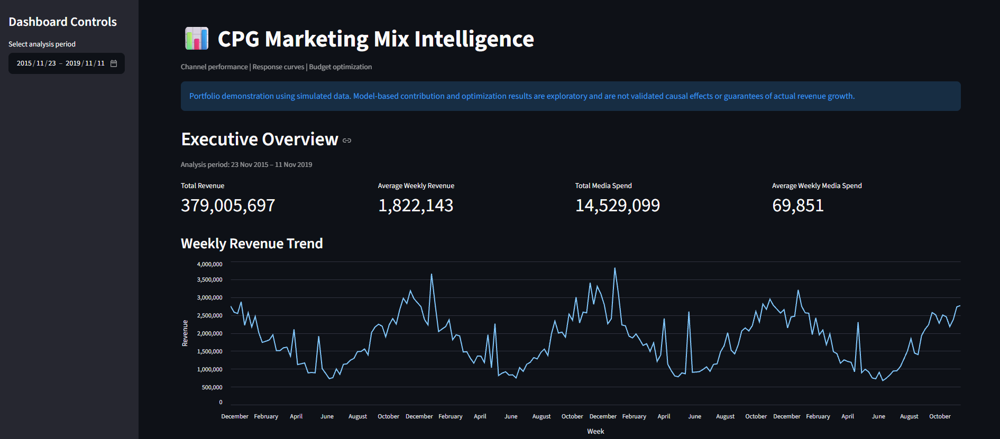
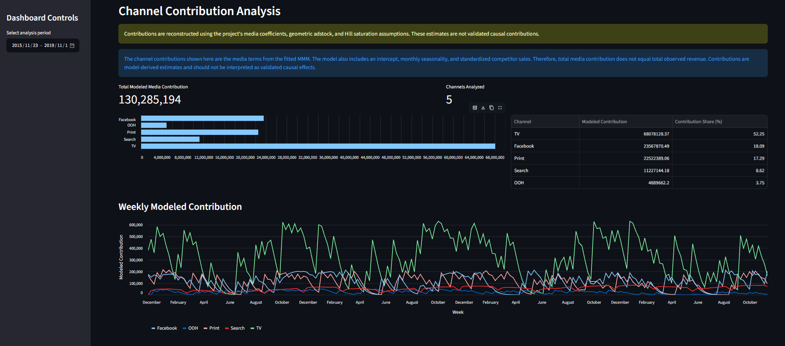
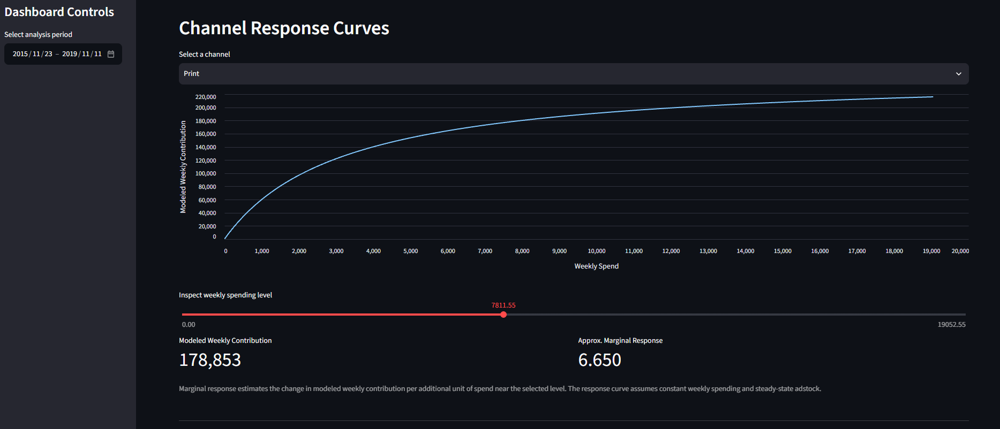
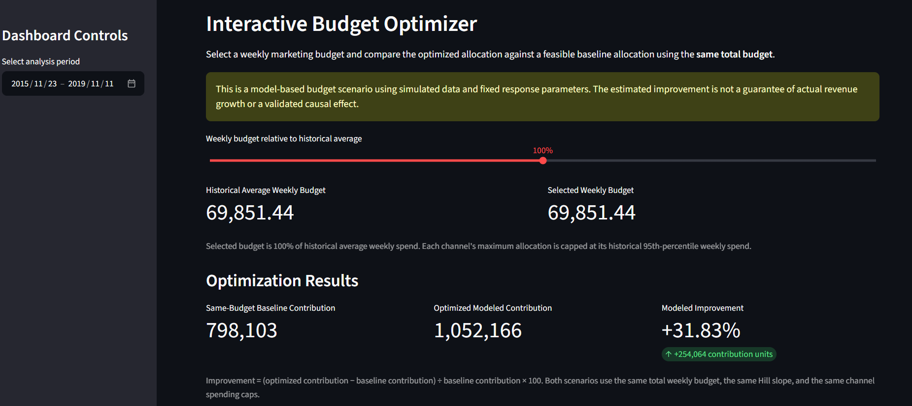

# Marketing Mix Modeling for a CPG Brand

**Channel Contribution Analysis · Response Curves · Budget Optimization**

An end-to-end Marketing Mix Modeling (MMM) project that analyzes the relationship between marketing investments and revenue for a simulated Consumer Packaged Goods (CPG) brand. The project combines regression modeling, adstock and saturation transformations, channel contribution analysis, response curves, and fixed-budget optimization in an interactive Streamlit dashboard.

## Project Overview

Marketing teams need to understand how different advertising channels relate to revenue, how marketing effects persist over time, and how to allocate budgets across channels.

This project builds a Marketing Mix Model using simulated weekly data to explore these questions. It compares a baseline regression model with a model incorporating geometric adstock and Hill saturation, evaluates out-of-sample performance, estimates channel-level media contributions, and optimizes media allocations under a fixed budget.

**Important:** The dataset is simulated. The results demonstrate an analytical workflow and should not be interpreted as validated causal estimates or real-world business recommendations.

## Key Features

- **Exploratory Data Analysis:** Investigates revenue trends, media spending, seasonality, correlations, and data quality.
- **Baseline Modeling:** Establishes a Ridge regression benchmark using media spend and monthly indicators.
- **Marketing Mix Modeling:** Applies geometric adstock to represent carryover effects and Hill saturation to represent diminishing returns.
- **Model Evaluation:** Uses a chronological train-test split and compares regression performance using R², MAE, RMSE, MAPE, and normalized RMSE.
- **Channel Contribution Analysis:** Estimates each channel's modeled contribution to revenue.
- **ROAS Proxies:** Compares modeled media contributions with historical channel spending.
- **Response Curves:** Examines modeled contributions and marginal responses across different spending levels.
- **Budget Optimization:** Allocates a fixed weekly budget across channels subject to spending bounds.
- **Sensitivity Analysis:** Evaluates how alternative Hill saturation slopes affect optimized allocations and modeled contributions.
- **Interactive Dashboard:** Provides visualizations, adjustable budgets, allocation comparisons, and data exploration through Streamlit.

## Technology Stack

- Python
- Pandas and NumPy
- Scikit-learn
- SciPy
- Matplotlib and Seaborn
- Jupyter Notebook
- Streamlit

## Dataset

The project uses the simulated weekly dataset provided with the Robyn demonstration data.

| Attribute | Description |
|---|---|
| Observations | 208 weekly records |
| Date range | November 23, 2015 – November 11, 2019 |
| Target variable | `revenue` |
| Media spend channels | TV, OOH, print, Facebook, and search |
| Additional variables | Facebook impressions, search clicks, competitor sales, events, and newsletter activity |

### Dataset files

- `data/dt_simulated_weekly.csv` — original dataset.
- `data/mmm_eda_clean.csv` — cleaned dataset generated during preprocessing.

### Main variables

| Variable | Description |
|---|---|
| `DATE` | Weekly observation date |
| `revenue` | Observed weekly revenue |
| `tv_S` | TV advertising spend |
| `ooh_S` | Out-of-home advertising spend |
| `print_S` | Print advertising spend |
| `facebook_S` | Facebook advertising spend |
| `search_S` | Search advertising spend |
| `facebook_I` | Facebook impressions |
| `search_clicks_P` | Search clicks |
| `competitor_sales_B` | Competitor sales measure |
| `events` | Event-related indicator |
| `newsletter` | Newsletter-related indicator |

The five `_S` media variables represent advertising spend. Facebook impressions and search clicks are separate activity measures and are not treated as spend.

## Project Structure

```text
Marketing-Mixed-Model-CPG/
├── app/
│   └── streamlit_app.py
├── data/
│   ├── dt_simulated_weekly.csv
│   └── mmm_eda_clean.csv
├── notebooks/
│   ├── 01_eda_and_preparation.ipynb
│   ├── 02_baseline_regression.ipynb
│   ├── 03_marketing_mix_model.ipynb
│   └── 04_budget_optimization.ipynb
├── screenshots/
│   ├── dashboard_overview.png
│   ├── channel_contributions.png
│   ├── response_curves.png
│   └── budget_optimization.png
├── .gitignore
├── README.md
└── requirements.txt
```

The screenshot files should be added after capturing the actual dashboard. Remove any screenshot entries you do not include.

## Methodology

### 1. Exploratory Data Analysis

The initial notebook examines data quality, weekly continuity, missing values, duplicate observations, revenue trends, seasonality, and relationships between revenue and media spend.

### 2. Baseline Regression

A Ridge regression model provides a benchmark using raw media spending variables and monthly indicators. The dataset is split chronologically, preserving the order of time rather than randomly shuffling observations.

### 3. Marketing Mix Model

The MMM incorporates two key transformations:

**Geometric adstock**

Represents the carryover of advertising effects over time.

\[
A_t = X_t + \alpha A_{t-1}
\]

Here, \(X_t\) is the current period's spend and \(\alpha\) is the adstock decay parameter.

**Hill saturation**

Represents diminishing marginal returns as advertising exposure increases.

\[
H(x) = \frac{x^s}{x^s + K^s}
\]

Here, \(K\) is the half-saturation parameter and \(s\) controls the curve's shape.

The model also includes monthly indicators and a standardized competitor-sales control. Media coefficients are constrained to be nonnegative.

### 4. Contribution and Response Analysis

The project estimates media contributions using the fitted model's transformed media features. It then examines historical contribution shares, contribution-to-spend proxies, and modeled response curves across different spend levels.

These are model-derived estimates, not independently validated causal effects.

### 5. Fixed-Budget Optimization

The optimizer uses SciPy's SLSQP algorithm to maximize modeled media contribution while:

- Maintaining the selected total weekly budget.
- Enforcing nonnegative spending.
- Respecting channel-specific upper bounds based on the historical 95th percentile of spend.
- Comparing optimized allocation with a feasible baseline at the same budget.
- Testing sensitivity to alternative Hill saturation slopes.

## Model Performance

The following results were obtained on the chronological holdout set of 42 weeks.

| Metric | Baseline Ridge | Marketing Mix Model |
|---|---:|---:|
| R² | 0.5997 | 0.8238 |
| MAE | 351,883 | 196,931 |
| RMSE | 412,915 | 273,917 |
| MAPE | 30.61% | 16.92% |
| Normalized RMSE | 0.1970 | 0.1307 |

The MMM achieved higher holdout R² and lower prediction errors than the baseline in this experiment. This indicates improved predictive performance on the selected holdout period, not proof of causal validity or guaranteed performance on real marketing data.

## Channel Contribution Analysis

Estimated media contributions over the full dataset were:

| Channel | Modeled contribution | Share of modeled media contribution |
|---|---:|---:|
| TV | 68.08M | 52.25% |
| Facebook | 23.57M | 18.09% |
| Print | 22.52M | 17.29% |
| Search | 11.23M | 8.62% |
| OOH | 4.89M | 3.75% |

The percentages represent shares of the sum of modeled media contributions, not shares of total observed revenue. The model also includes an intercept, monthly effects, and a competitor-sales control.

The contribution-to-spend figures are exploratory proxies rather than validated incremental ROAS estimates.

## Budget Optimization Results

Using the historical average weekly media budget as the reference:

| Metric | Result |
|---|---:|
| Historical average weekly budget | 69,851.44 |
| Current modeled weekly media contribution | 798,102.58 |
| Optimized modeled weekly media contribution | 1,052,166.09 |
| Modeled contribution improvement | 31.83% |

The optimizer shifted budget toward TV, print, Facebook, and search while reducing OOH spending to zero under the default response-curve assumptions and constraints.

The improvement is a simulated, model-based optimization result. It does not mean that real-world revenue would increase by 31.83%. The result depends on the fitted response curves, selected budget, spending bounds, and model assumptions.

## Dashboard

The Streamlit dashboard includes:

1. Executive overview and revenue trends.
2. Channel contribution analysis.
3. Interactive media response curves.
4. Fixed-budget optimization.
5. Sensitivity analysis.
6. Data explorer.

### Dashboard screenshots

Add screenshots of the actual running application to the `screenshots/` directory. You can then display them in this README:

#### Executive Overview



#### Channel Contributions



#### Response Curves



#### Budget Optimization



## Installation and Usage

### Prerequisites

- Python 3.12 recommended for the development environment.
- Git.
- A terminal or IDE such as VS Code.

### 1. Clone the repository

```bash
git clone https://github.com/YOUR_USERNAME/marketing-mix-model-cpg.git
cd marketing-mix-model-cpg
```

Replace `YOUR_USERNAME` with your GitHub username.

### 2. Create a virtual environment

**Windows PowerShell:**

```powershell
py -3.12 -m venv .venv
.\.venv\Scripts\Activate.ps1
```

If PowerShell blocks environment activation, you can invoke the environment's Python executable directly instead.

### 3. Install dependencies

```bash
python -m pip install --upgrade pip
python -m pip install -r requirements.txt
```

### 4. Launch the dashboard

```bash
python -m streamlit run app/streamlit_app.py
```

Streamlit will provide a local URL in the terminal, usually `http://localhost:8501`.

### 5. Explore the notebooks

Open the notebooks in Jupyter or VS Code in the following order:

1. `01_eda_and_preparation.ipynb`
2. `02_baseline_regression.ipynb`
3. `03_marketing_mix_model.ipynb`
4. `04_budget_optimization.ipynb`

Run them in order to follow the analysis from data preparation through modeling and optimization.

## Limitations and Future Improvements

- **Simulated data:** Findings do not establish real-world marketing effectiveness.
- **Causal interpretation:** Correlation and modeled contribution are not equivalent to incremental causal impact.
- **Model assumptions:** Adstock decay, Hill saturation, and model specification influence the results.
- **Parameter uncertainty:** The current workflow does not provide full Bayesian posterior uncertainty or comprehensive parameter estimation.
- **External validation:** Results have not been validated against real campaign experiments or lift studies.
- **Optimization risk:** Optimal allocations depend on response curves and constraints and should not be implemented as real budget recommendations without validation.

Potential future improvements include:

- Estimating adstock and saturation parameters through systematic hyperparameter search.
- Adding uncertainty intervals for channel contribution and budget allocation.
- Comparing additional regression and Bayesian MMM approaches.
- Validating incremental effects with experiments or lift studies.
- Adding scenario comparisons and downloadable budget recommendations.
- Deploying the dashboard for public access.

## Key Takeaway

This project demonstrates an end-to-end marketing analytics workflow: exploratory analysis, predictive modeling, media-effect transformations, contribution analysis, response-curve modeling, constrained budget optimization, sensitivity analysis, and interactive reporting.

It is intended as a portfolio demonstration of Python, machine learning, statistical modeling, and business-oriented analytical thinking.

## Author

**NEEL BOKIL**

Replace the placeholders with your profile information before publishing.

